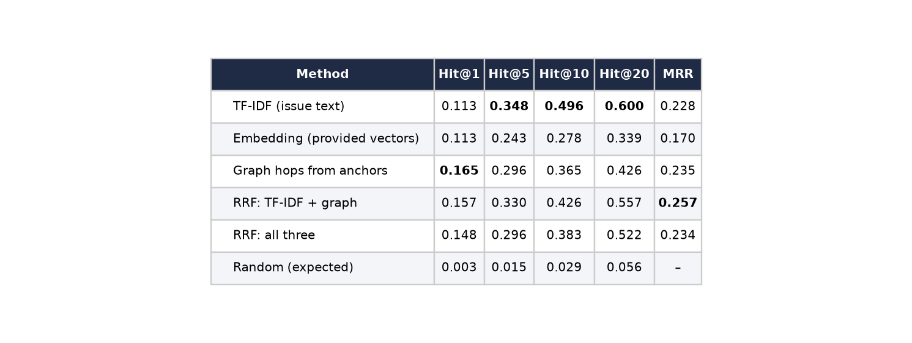
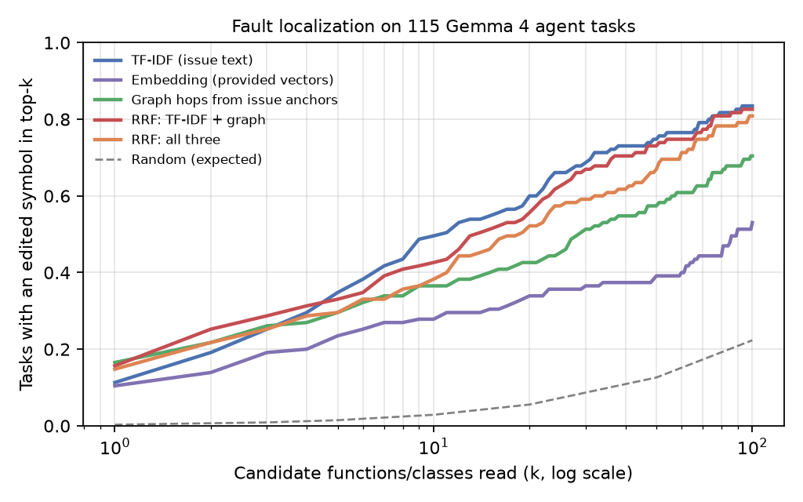
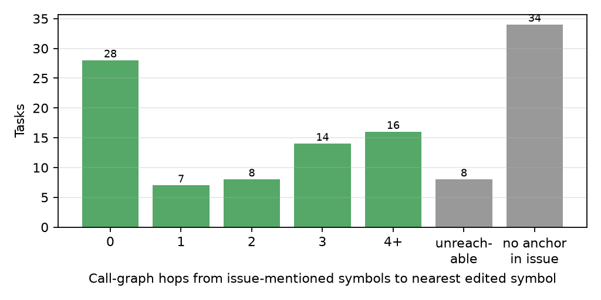
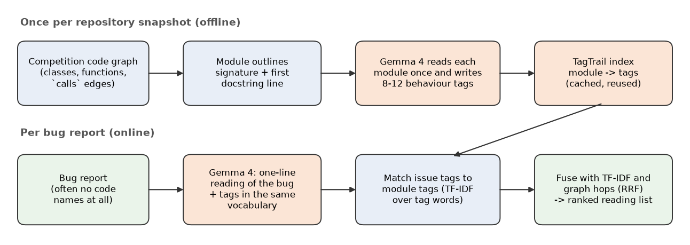
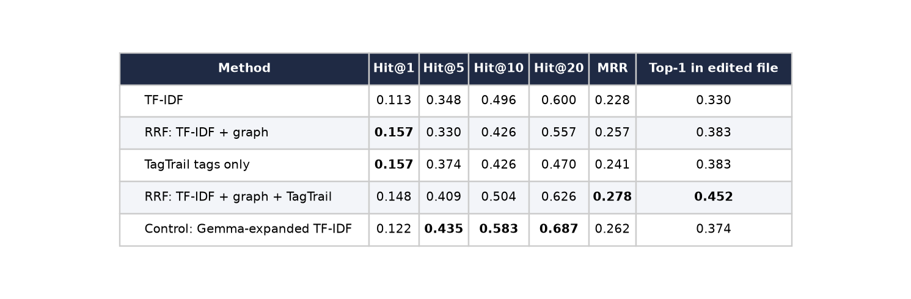
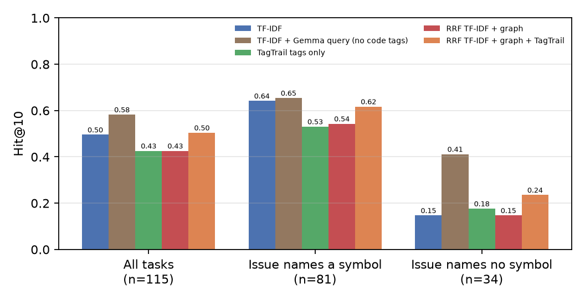
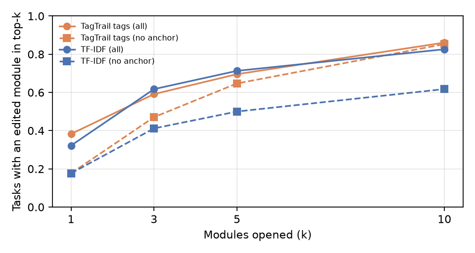

## Abstract

Small local models often fail at the first step of a fix: they open the wrong part of the repository and spend their context before reaching the bug. We measure that step on the 129 public tasks of the Gemma 4 Developer Agent competition. First, each reference patch is mapped to the graph symbols it edits. The bug report names an edited symbol in only 28 of the 115 usable tasks, and names no code symbol at all in 34. Walking the provided call graph from the named symbols gives the best first guess (hit@1 0.165), and identifier-aware TF-IDF is best once an agent can read five or more symbols (hit@10 0.496). The shipped embeddings, which the official `search_similar_code` tool can only query by symbol name, are the weakest signal.

To attack the reports that name nothing, we built **TagTrail**. Gemma 4 E4B reads an outline of every library module once (247 unique modules, 15 minutes on two T4 GPUs) and writes behaviour tags. At query time it rewrites the bug report into the same tag vocabulary. On those reports, TagTrail puts an edited module in the top 10 for 85% of tasks, against 62% for TF-IDF. Adding it to TF-IDF + graph fusion raises hit@10 from 0.426 to 0.504. A control did better still at function level: Gemma's reading of the bug, appended to the query with no code index at all, gave hit@10 0.583 overall and 0.412 on the no-name slice (TF-IDF: 0.147). We release the gold map, the tag index, all prompts and both notebooks.

## 1. Introduction

I started this after watching coding agents get lost. The pattern repeats. The agent reads the bug report, picks a file that sounds right, opens it, and then opens three more. By the time it reaches the function that needs changing, half the context window is gone, and the rest goes into a patch in the wrong place. A big hosted model can absorb that waste. A 4-bit Gemma 4 on one accelerator, which is the setting of this competition, can't.

So before building anything I wanted numbers for that first step. Where do the real fixes live, compared with what the bug report says? How much does the provided code graph help? And what happens with reports that describe a behaviour ("the export has the wrong colours") without naming any code?

This paper makes three contributions:

1. **A gold localization map** for the public split. Each patch hunk is mapped to the symbol it edits, together with the issue's anchor symbols and the call-graph distance between them.
2. **A measurement study** of four training-free rankers under one protocol, showing when each works and where all of them fail.
3. **TagTrail**, a read-once Gemma 4 tag layer for that failure case. It is evaluated with a control that separates "Gemma indexed the code" from "Gemma just read the bug". Everything is released as a resource.

## 2. Related Work

**Agents and benchmarks.** SWE-bench (Jimenez et al., 2024) made resolving real GitHub issues, checked by tests, the standard task for coding agents; the competition shares its format. SWE-agent (Yang et al., 2024) showed that the tool interface matters. OpenHands (Wang et al., 2024) is an open agent platform. AutoCodeRover (Zhang et al., 2024) searches over program structure.

**Localization and repository understanding.** Agentless (Xia et al., 2024) showed that a fixed localize, repair and validate pipeline competes with open-ended agents. LocAgent (Chen et al., 2025) lets an LLM walk a code graph. RepoGraph (Ouyang et al., 2024) adds a line-level repository graph to agents. CodexGraph (Liu et al., 2024) lets the model query a graph database. LingmaAgent (Ma et al., 2024; first released as RepoUnderstander) is closest to TagTrail: it condenses a repository into a knowledge graph with LLM-written summaries. We differ in three ways. Our index is written by a small local model, in a fixed tag vocabulary that the bug report is mapped into too. We score it against gold labels on the issues that name no code. And we compare it with a query-rewriting control.

**IR bug localization.** BLUiR (Saha et al., 2013) showed that structured retrieval over code fields beats flat text; our TF-IDF ranker descends from that line of work. Rankers are fused with reciprocal rank fusion (Cormack et al., 2009) at its published constant, so nothing is tuned on the test tasks. Gemma models (Gemma Team, 2025) are open-weight models built for single accelerators.

## 3. Data and Gold Map

The public split has 129 tasks: fastapi 67, rich 48, requests 13 and httpx 1. Each task has a problem statement, a base commit and a reference patch. Each snapshot has a code graph and an embedding archive, named `<repo>_<base_commit>` on Kaggle. Graph nodes are classes and functions; the ID is the dotted path and the text is the source. Every edge is of type `calls`, and the median is 0.68 edges per node. There are no module nodes, so a symbol's module is the longest dotted prefix that is not itself a node.

**Gold symbols.** The patches have no `diff --git` headers, so we split files on `---`/`+++` pairs. Tests, documentation examples and new files are skipped. For each hunk, the removed lines are matched verbatim against the symbols in the edited module; for pure additions, the context lines are used instead. Each matching line scores a point, a name match with the hunk header adds 0.5, and ties go to the shortest source, so a method beats its class. Of 632 hunks, 455 (72%) map to a symbol. The 115 tasks with at least one gold symbol among the non-test candidates form the evaluation set. 49 of them edit more than one symbol.

**Anchors.** A node is an anchor if the issue mentions its ID or a dotted suffix of it. It is also an anchor if its short name matches an identifier in the issue that has at least four characters, is not a generic word, and names at most ten nodes. Hints are never used.

## 4. Part 1: Where Small Agents Get Lost

All rankers order the same candidates: the non-test symbols, a median of 1,155 per task.
- **TF-IDF** matches the issue against each symbol's ID and source, with identifiers split into words and IDF computed per repository.
- **Graph** orders symbols by undirected hop distance from the anchors, falling back to TF-IDF when there are none.
- **Embedding** scores the best cosine similarity to the anchors, or to the top-5 TF-IDF symbols. This matches how the official `search_similar_code` works: the harness README says it resolves a symbol name and has no text encoder.
- **RRF** fuses rankers with k = 60.

Random hit@k is computed exactly as 1 − C(N−g, k)/C(N, k).



*Table 1. Function-level localization on 115 tasks: share of tasks with an edited symbol in the top k.*


*Figure 1. Hit@k against reading budget (log x-axis).*

**The best ranker depends on the budget.** Graph hops win at k = 1, TF-IDF + graph fusion leads at k = 2–4, and TF-IDF leads or ties from 5 to 100. Adding the embeddings to the fusion lowers every column.


*Figure 2. Call-graph hops from the issue's anchors to the nearest edited symbol.*

**Fixes are either named or far away.** In 28 tasks the issue names an edited symbol outright, and hops 1–2 add only 15 more. Of the 73 reachable fixes, 30 (41%) are three or more hops out, and another 8 are unreachable. Walks also get expensive fast: the median anchor neighbourhood is 13 symbols at radius 1 and 67 at radius 2. A full 2-hop walk costs as much as reading 67 TF-IDF hits, yet it reaches 43 tasks against TF-IDF's 89 (0.774).

**No anchor, no luck.** On the 81 tasks with anchors, TF-IDF reaches hit@10 0.642. On the 34 without anchors, every ranker in Table 1 stays at hit@10 0.147 or below. That is the gap TagTrail goes after.

## 5. Part 2: TagTrail

The idea is to let Gemma 4 read the repository once, offline, and leave behind a small index. Later bug reports can be matched against it by meaning rather than by name.


*Figure 3. TagTrail: an offline read-once pass (top) and a per-report pass (bottom).*

**Read once.** For every library module we build an outline: each symbol's signature and the first line of its docstring, top-level symbols first, capped at 3,500 characters. Outlines are de-duplicated across the 127 snapshots by content hash, because most modules don't change between commits, which leaves only 247 to read. Gemma 4 E4B-it (bf16, greedy decoding, thinking off) writes 8–12 tags of two to four words for each one. For example, `fastapi.applications` gets "route definition, websocket handling, middleware configuration, openapi generation, …". The index is cached and reused for every task.

**Tag the bug.** Gemma 4 reads the report, writes one sentence saying what's wrong, and then gives 8–12 tags in the same style. It is told it cannot see the code and should prefer plain words over code names. One report about `convert_underscores` became "header parsing, request handling, configuration options, …".

**Route.** Modules are scored by TF-IDF cosine between the issue tags and each module's tags, with a light plural strip. Symbols inherit their module's score, with ties broken by plain TF-IDF. We also fuse TagTrail with TF-IDF and graph hops (RRF, k = 60).

**Control.** Any gain might come from Gemma *reading the bug*, not from the index over the code. So we also append Gemma's sentence and tags to the issue and rerun plain code TF-IDF ("Gemma-expanded TF-IDF"). It uses the same model outputs but no code-side index.

## 6. TagTrail Results



*Table 2. Function-level results on all 115 tasks.*


*Figure 4. Hit@10 on all tasks, on tasks whose issue names a symbol, and on tasks whose issue names none.*

**TagTrail finds the right module.** Ranking modules (median 249 per snapshot) by tags beats ranking them by their best TF-IDF symbol. Over all tasks it gets module hit@1 0.383 against 0.322, and hit@10 0.861 against 0.826. The gap is largest where it matters: on the 34 no-anchor tasks, module hit@5 is 0.647 against 0.500 and hit@10 is 0.853 against 0.618 (Figure 5). Matching bug reports to code by meaning works at module level.


*Figure 5. Share of tasks with an edited module among the top-k modules.*

**It helps the fusion.** Adding TagTrail to TF-IDF + graph raises hit@10 from 0.426 to 0.504, MRR from 0.257 to 0.278, and top-1 file accuracy from 0.383 to 0.452. Per task, the fused rank of the first gold symbol improves in 53 tasks and gets worse in 37.

**But the control wins at function level.** Gemma-expanded TF-IDF is the best ranker for k = 5 to 82, and on the no-anchor slice it nearly triples hit@10 (0.412 against 0.147). Tags alone reach 0.176 there, and the fusion with tags 0.235. Head to head, the control ranks the first gold symbol higher than tags-only in 66 tasks and lower in 37.

**What this means.** My hypothesis held halfway. A read-once tag index does route a vague bug report to the right *module* much more often. But once you are inside a module, tags are too coarse: every symbol in the module gets the same score. What carried most of the function-level gain was the step before any index, namely Gemma turning a prose complaint into words that also appear in the code. For a small agent, the practical recipe is cheap. First, ask Gemma 4 for a one-line reading of the bug plus some tags. Use those words to search the code. Use the tag index to choose which modules to open first. We have not tested that combination yet; it is the next experiment.

## 7. The Resource: TagTrail data and harness

We release under Apache 2.0:

- **Gold localization map** (`results.json`): for every task, the edited symbols, mapped hunks, anchors, hop distance, neighbourhood sizes and the rank from every ranker. Any team can use it to score a localization step without running a full agent.
- **TagTrail index** (`kg_tags.json`): Gemma 4 tags for all library modules in all 129 task snapshots, plus each issue's one-line reading and tags, raw model outputs and both prompts.
- **Harness**: a CPU evaluation notebook, a GPU tagging notebook, and a script that rebuilds every table and figure here.

## 8. Limitations

- **No resolve rate.** We measure localization only. Feeding each ranking to a Gemma 4 agent and counting fixed tasks is the obvious next step.
- **Small split.** There are 115 usable tasks, mostly fastapi and rich, and the hidden test set may differ. With 34 no-anchor tasks, one task moves hit@10 by about 3 points.
- **Heuristic gold.** 28% of hunks did not map to a symbol, and new files are excluded. Other valid fixes may touch other functions.
- **One model, one prompt.** E4B with greedy decoding and untuned prompts. Larger Gemma 4 models, or tags at symbol level instead of module level, may change the picture.

## 9. Reproduce

Evaluation runs on a Kaggle CPU in about 2 minutes. Tagging runs on Kaggle with 2× T4: about 26 minutes in total, including model load, 247 modules and 129 reports.

- Evaluation notebook: https://www.kaggle.com/code/cosmicmagnetar/gemma-4-code-graph-localization
- Tagging notebook: https://www.kaggle.com/code/cosmicmagnetar/gemma-4-read-once-tag-layer
- Code: https://github.com/CosmicMagnetar/gemma4-code-graph-localization
- Dataset: https://www.kaggle.com/datasets/cosmicmagnetar/tagtrail-gemma4-localization

```bash
kaggle kernels push -p tagkg --accelerator NvidiaTeslaT4    # Gemma 4 tags -> kg_tags.json
kaggle kernels push -p analysis                             # evaluation -> results.json
python figures/make_figures.py results/results.json         # every table and figure
```

## References

- Chen, Z., Tang, X., Deng, G., et al. (2025). *LocAgent: Graph-Guided LLM Agents for Code Localization.* arXiv:2503.09089.
- Cormack, G. V., Clarke, C. L. A., & Buettcher, S. (2009). *Reciprocal rank fusion outperforms Condorcet and individual rank learning methods.* SIGIR. doi:10.1145/1571941.1572114
- Gemma Team (2025). *Gemma 3 Technical Report.* arXiv:2503.19786.
- Jimenez, C. E., Yang, J., Wettig, A., et al. (2024). *SWE-bench: Can Language Models Resolve Real-World GitHub Issues?* ICLR. arXiv:2310.06770.
- Liu, X., Lan, B., Hu, Z., Liu, Y., et al. (2024). *CodexGraph: Bridging Large Language Models and Code Repositories via Code Graph Databases.* arXiv:2408.03910.
- Ma, Y., Yang, Q., Cao, R., Li, B., et al. (2024). *Alibaba LingmaAgent: Improving Automated Issue Resolution via Comprehensive Repository Exploration.* arXiv:2406.01422.
- Markowitz, E., Perozzi, B., Rózemberczki, B., et al. (2026). *Google – The Gemma 4 Developer Agent Paper Track.* Kaggle.
- Ouyang, S., Yu, W., Ma, K., et al. (2024). *RepoGraph: Enhancing AI Software Engineering with Repository-level Code Graph.* arXiv:2410.14684.
- Saha, R. K., Lease, M., Khurshid, S., & Perry, D. E. (2013). *Improving bug localization using structured information retrieval.* ASE. doi:10.1109/ASE.2013.6693093
- Wang, X., Li, B., Song, Y., et al. (2024). *OpenHands: An Open Platform for AI Software Developers as Generalist Agents.* arXiv:2407.16741.
- Xia, C. S., Deng, Y., Dunn, S., & Zhang, L. (2024). *Agentless: Demystifying LLM-based Software Engineering Agents.* arXiv:2407.01489.
- Yang, J., Jimenez, C. E., Wettig, A., et al. (2024). *SWE-agent: Agent-Computer Interfaces Enable Automated Software Engineering.* arXiv:2405.15793.
- Zhang, Y., Ruan, H., Fan, Z., & Roychoudhury, A. (2024). *AutoCodeRover: Autonomous Program Improvement.* arXiv:2404.05427.
