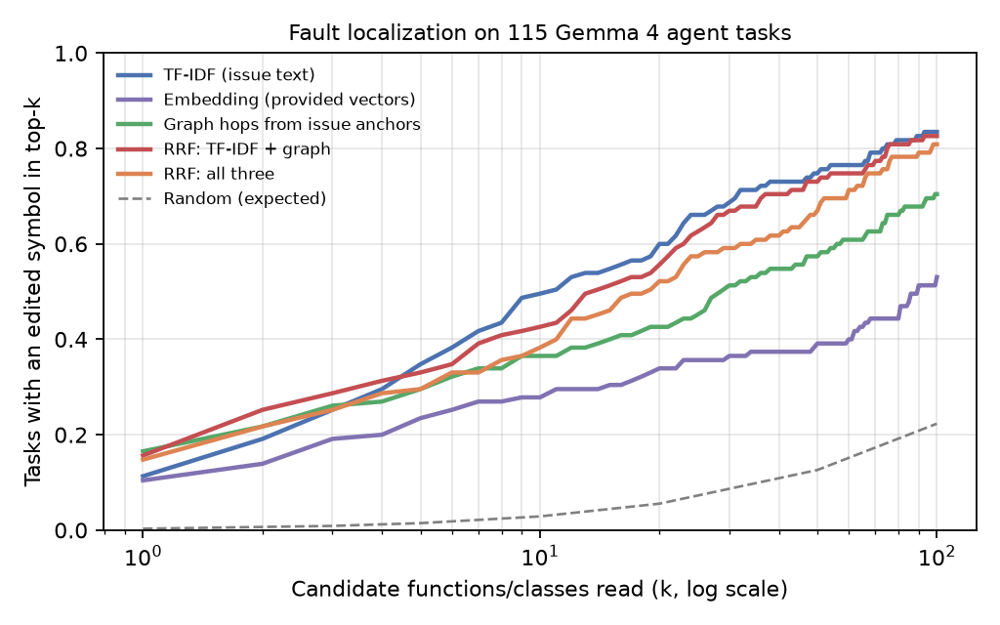
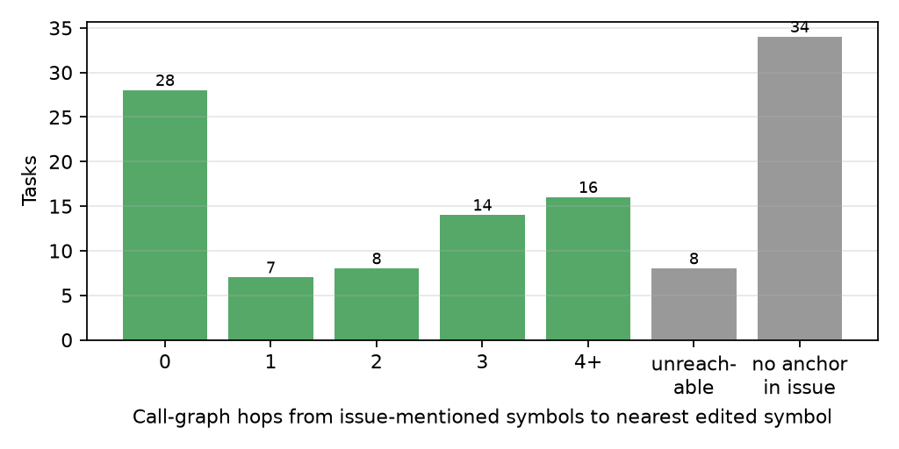

# Where Do the Fixes Live? Code-Graph Fault Localization for Small Local Coding Agents

**Subtitle:** A training-free study of the 129 public Gemma 4 Developer Agent tasks: how far reference fixes sit from the symbols an issue mentions, and which cheap rankers find them before a model reads any code.

## Abstract

A small model running on one accelerator cannot afford to read a whole repository. Before Gemma 4 can draft a fix it has to decide *where to look*, and that decision is made with a few tool calls over a limited context window. We measure how hard that first step is on the 129 public tasks of the Gemma 4 Developer Agent competition (fastapi, rich, requests, httpx), using only the artefacts the competition ships: the AST call/dependency graphs, the 256-dimensional node embeddings, and the issue text. We map every reference patch to the graph nodes it edits, extract the symbols each issue names, and measure (i) the call-graph distance between named and edited symbols and (ii) how well four training-free rankers place an edited symbol near the top: issue-to-code TF-IDF, graph hops from issue anchors, similarity in the provided embedding space, and reciprocal-rank fusion of these. TBD-RESULT-SENTENCE. The whole study runs on a Kaggle CPU notebook in TBD seconds and needs no model calls, so it can serve as a reproducible localization baseline and as a cheap pre-step that hands a Gemma 4 agent a short, ranked reading list.

## 1. Introduction

<!-- REWRITE IN MY VOICE: motivation. Why localization on everyday hardware matters to you; what you saw or expected when thinking about small agents in big repos. -->
Coding agents built on large hosted models can afford to explore. They list directories, open many files, and recover from wrong turns because each extra step is cheap relative to their context and budget. A model that fits on a laptop or a single accelerator does not have that slack. Every file it opens costs context, and a wrong first guess about where the bug lives is often the whole failure: the agent edits the wrong function, tests fail, and the remaining turns are spent undoing it.

The Gemma 4 Developer Agent competition anticipates this. Alongside each repository snapshot it ships a code graph (functions, classes and modules as nodes; calls and references as edges), a dense embedding per node, and tools such as `get_code_neighbors`, `get_code_subgraph` and `search_similar_code` built on them. What is not yet known is how useful these structures are for the first decision an agent makes. Are the functions that need editing usually named in the issue? If not, are they one call away, or far away? Does the provided embedding space put them near the symbols the issue mentions?

This paper answers those questions with measurements rather than with a new agent. Our contributions are:

1. **A gold localization map for the public split.** We map each reference patch, hunk by hunk, to the most specific graph node whose source contains the edited lines, and report how often this mapping succeeds (Section 3.1).
2. **A distance profile of real fixes.** For every task we measure the shortest call-graph distance between symbols named in the issue and the nearest edited symbol (Section 4.2).
3. **A training-free localization baseline.** We compare lexical, graph, embedding and fused rankers under one protocol, with a random baseline computed exactly, and report hit@k and MRR at function level (Section 4.1).
4. **A reproducible notebook.** All numbers come from one public Kaggle notebook that runs on CPU against the competition data, plus a figure script that reads its JSON output (Section 7).

## 2. Related Work

**Benchmarks and agents.** SWE-bench (Jimenez et al., 2024) established resolving real GitHub issues, verified by repository tests, as the standard task for software-engineering agents; the competition tasks follow the same format (problem statement, base commit, reference patch, test patch). SWE-agent (Yang et al., 2024) showed that the agent-computer interface (the shape of the tools) strongly affects success, and OpenHands (Wang et al., 2024) provides an open platform for such agents. AutoCodeRover (Zhang et al., 2024) added program-structure-aware code search over classes and methods, which is close in spirit to the graph tools provided in this competition.

**Localization as a separate stage.** Agentless (Xia et al., 2024) showed that a fixed pipeline of hierarchical localization, repair and patch validation is competitive with open-ended agents, which suggests that localization quality is a major lever. LocAgent (Chen et al., 2025) builds a heterogeneous graph of files, classes and functions and lets an LLM agent traverse it for localization; RepoGraph (Ouyang et al., 2024) adds a line-level repository graph as a plug-in to existing agent frameworks and reports gains on SWE-bench. Our work is complementary: instead of proposing another graph-guided agent, we measure, on the exact graphs and embeddings shipped to Gemma 4 participants, how far fixes are from issue-mentioned symbols and how much simple, model-free use of the graph already buys.

**Information-retrieval bug localization.** Before LLMs, bug localization was framed as retrieving source files for a bug report; BLUiR (Saha et al., 2013) showed that exploiting code structure (class, method, identifier fields) improves over flat text retrieval. Our TF-IDF ranker with identifier splitting is a function-level descendant of that line of work. To combine rankers without tuning on the evaluation tasks we use reciprocal rank fusion (Cormack et al., 2009) with its standard constant.

**Gemma.** Gemma models (Gemma Team, 2025) are open-weight models designed to run on single accelerators and consumer hardware, which is the setting that motivates our budget-centred evaluation.

## 3. Method

### 3.1 Data and gold localization

We use the public split of the competition: `tasks.jsonl` (129 tasks with problem statement, base commit and reference `patch`), one graph per task in NetworkX node-link JSON (`graphs/<instance_id>.json`; node `id` is the fully qualified symbol path and `text` its source), and one `.npz` per task mapping node ids to 256-dimensional float32 vectors (`embeddings/<instance_id>.npz`). We do not use the repository snapshots, the test patches or any model.

The reference patch tells us which *lines* change, but the agent's tools work on *symbols*. We bridge the two as follows. We parse each unified diff into files and hunks and ignore test files, documentation and newly created files (which have no node at the base commit). For each remaining hunk we take its removed lines (or, for pure additions, its context lines), drop trivial lines (`pass`, `return`, bare brackets, comments, anything shorter than four characters), and restrict candidates to nodes inside the edited module (path `src/pkg/a/b.py` → `pkg.a.b`). Each candidate is scored by how many probe lines appear verbatim in its source, with a +0.5 bonus when its name matches the function named in the hunk header. The highest-scoring node wins, and ties go to the node with the shortest source, so that a method beats the class that contains it. A task's gold set is the union over its hunks. Tasks with no mappable hunk are reported and excluded from ranking metrics.

### 3.2 Issue anchors

An agent's first clue is the identifiers in the issue. We extract all identifier and dotted-identifier tokens from the problem statement. A node becomes an *anchor* if its full id or a dotted suffix of it is mentioned, or if its short name (last path component) equals any mentioned identifier component that is at least four characters long, is not a generic word (`self`, `request`, `value`, …), and names at most ten nodes in the repository. The last filter keeps common names from flooding the anchor set. Hints and maintainer comments are not used.

### 3.3 Rankers

All rankers order the same candidate set: every node in the task's graph except nodes under test or documentation packages. Hints are not used.

- **TF-IDF.** Issue text versus node id plus source, with identifiers split on non-alphanumerics, underscores and camelCase, sublinear term frequency and IDF computed per repository. This is a function-level analogue of classic IR bug localization.
- **Graph.** Breadth-first search over the *undirected* call/reference graph from all anchors; nodes are ordered by hop distance, ties broken by TF-IDF. With no anchors it degrades to TF-IDF.
- **Embedding.** Cosine similarity, in the provided embedding space, between each node and its nearest seed. Seeds are the anchors or, without anchors, the top five TF-IDF nodes. The competition does not ship a query encoder for natural language, so the embedding space is used node-to-node, exactly as `search_similar_code` would use it from a symbol the agent already holds.
- **Fusion.** Reciprocal rank fusion with k = 60 (Cormack et al., 2009) of TF-IDF + graph, and of all three rankers. The constant is the published default; nothing is tuned on these tasks.

### 3.4 Metrics

For each task and ranker we record the rank of the first gold node. We report hit@k (the fraction of tasks with a gold node in the top k), mean reciprocal rank, and whether the top-1 node lies in an edited module (file-level hit@1). The random baseline is computed exactly: with N candidates and g gold nodes, expected hit@k = 1 − C(N−g, k)/C(N, k). We also report, per task, the minimum hop distance from anchors to gold and the size of the 1-, 2- and 3-hop neighbourhood around the anchors, which is the amount of code a graph-walking agent would need to read to reach that radius.

## 4. Results

TBD: filled from `results/results.json` via `figures/make_figures.py`.

### 4.1 Localization accuracy

TBD table.



### 4.2 How far are fixes from the issue?

TBD.



### 4.3 Per-repository breakdown

TBD.

## 5. Discussion: what this means for a Gemma 4 agent

<!-- REWRITE IN MY VOICE: key insight. In your own words, what should someone building a small local agent do differently after seeing these numbers? -->
TBD.

## 6. Limitations

<!-- REWRITE IN MY VOICE: limitations. Say plainly what you would do with more time and what you are unsure about. -->
- **No model in the loop.** We measure the localization step that precedes generation; we did not run Gemma 4 on these tasks, so we cannot claim that better rankings raise resolve rate. The natural next experiment is to hand each ranker's top-k list to a Gemma 4 agent and measure the change in resolved tasks.
- **Small public split.** 129 tasks from four HTTP/terminal libraries. Results may not transfer to larger or differently structured repositories, and the hidden test set may differ.
- **Heuristic gold mapping.** Line matching can attribute a hunk to the wrong node when identical lines appear in several functions, and edits to module-level code map to the module node. We report the mapping success rate rather than hiding it.
- **Single reference fix.** Gold is the maintainers' patch. Other correct fixes could edit different functions, so hit@k is a lower bound on useful localization.
- **Anchor heuristic.** Name matching misses symbols described only in prose and can over-match common names; the ten-node ambiguity cap is a judgment call, not a tuned value.
- **Embeddings used node-to-node.** Without a text encoder matched to the provided vectors we cannot test issue-to-code embedding retrieval directly.

## 7. Reproduce

- **Hardware:** Kaggle CPU notebook (no GPU, no internet needed). Figures were made on a laptop with Python 3.14, numpy, matplotlib.
- **Notebook:** TBD-NOTEBOOK-LINK (public Kaggle notebook, competition data `gemma-4-developer-agent` attached).
- **Code:** TBD-REPO-LINK.

```bash
# 1. On Kaggle: import analysis/localize.ipynb into a notebook with the competition data attached, Run All.
#    It writes /kaggle/working/results.json (runtime TBD s on CPU).
# 2. Locally, with the downloaded results.json:
pip install numpy matplotlib
python figures/make_figures.py results/results.json   # writes figures/*.png and prints every table in this paper
# Optional local run of the analysis itself, if you have the data:
DATA_DIR=/path/to/competition/data python analysis/localize.py
```

## References

- Chen, Z., Tang, X., Deng, G., et al. (2025). *LocAgent: Graph-Guided LLM Agents for Code Localization.* arXiv:2503.09089. https://arxiv.org/abs/2503.09089
- Cormack, G. V., Clarke, C. L. A., & Buettcher, S. (2009). *Reciprocal rank fusion outperforms Condorcet and individual rank learning methods.* SIGIR 2009. https://doi.org/10.1145/1571941.1572114
- Gemma Team (2025). *Gemma 3 Technical Report.* arXiv:2503.19786. https://arxiv.org/abs/2503.19786
- Jimenez, C. E., Yang, J., Wettig, A., et al. (2024). *SWE-bench: Can Language Models Resolve Real-World GitHub Issues?* ICLR 2024. arXiv:2310.06770. https://arxiv.org/abs/2310.06770
- Markowitz, E., Perozzi, B., Rózemberczki, B., et al. (2026). *Google – The Gemma 4 Developer Agent Paper Track.* Kaggle. https://www.kaggle.com/competitions/gemma-4-developer-agent-paper
- Ouyang, S., Yu, W., Ma, K., et al. (2024). *RepoGraph: Enhancing AI Software Engineering with Repository-level Code Graph.* arXiv:2410.14684. https://arxiv.org/abs/2410.14684
- Saha, R. K., Lease, M., Khurshid, S., & Perry, D. E. (2013). *Improving bug localization using structured information retrieval.* ASE 2013. https://doi.org/10.1109/ASE.2013.6693093
- Wang, X., Li, B., Song, Y., et al. (2024). *OpenHands: An Open Platform for AI Software Developers as Generalist Agents.* arXiv:2407.16741. https://arxiv.org/abs/2407.16741
- Xia, C. S., Deng, Y., Dunn, S., & Zhang, L. (2024). *Agentless: Demystifying LLM-based Software Engineering Agents.* arXiv:2407.01489. https://arxiv.org/abs/2407.01489
- Yang, J., Jimenez, C. E., Wettig, A., et al. (2024). *SWE-agent: Agent-Computer Interfaces Enable Automated Software Engineering.* arXiv:2405.15793. https://arxiv.org/abs/2405.15793
- Zhang, Y., Ruan, H., Fan, Z., & Roychoudhury, A. (2024). *AutoCodeRover: Autonomous Program Improvement.* arXiv:2404.05427. https://arxiv.org/abs/2404.05427
